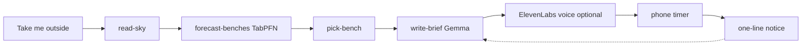

# Stillbench

**Live demo:** [stillbench.onrender.com](https://stillbench.onrender.com) · **Integrations:** [/integrations](https://stillbench.onrender.com/integrations) · **DEV submission (Week 1 — Touch Grass):** [draft on DEV](https://dev.to/smriad/stillbench-open-gemma-tabpfn-for-twelve-minutes-outside-touch-grass-49l-temp-slug-2358043) · **Repo:** [github.com/smriad/stillbench](https://github.com/smriad/stillbench)

Sit outside for **twelve minutes**. Stillbench picks a nearby bench, speaks a short **Gemma** brief once, then times your sit while the phone stays in your pocket. It is not a quest app, a streak game, or a garden planner—the screen is the short part; the sit is the product.

Optional **This sit is for…** names who the sit is for. TabPFN shows a plain **why this bench** line (light, last bail, leave probability). **Take me outside** is twelve minutes. **The street is too much** is six minutes at the closest bench (the roof counts). **Sit with someone** adds a line you can play for the person next to you. Check-in text shares a **return time, not GPS**. Afterward: one noticing prompt, optional debrief for the next visitor, and **Copy sit story (markdown)** on the done screen. **Practice sit, twenty seconds** is the same flow and is not training data.

Briefs can mention the air outside when `STILLBENCH_HOME` is set (Open-Meteo). The latest brief and voice file can stay on the phone for offline replay.

## Demo (about sixty seconds)

On your phone: open the [live demo](https://stillbench.onrender.com) → optional dedication → **Take me outside** → listen once → **I'm leaving** → **I'm sitting** → pocket the phone until the chime. Free tier may sleep; first load after idle can take ~1 minute. Check [/integrations](https://stillbench.onrender.com/integrations) for partner status on production.

## How it is built

Open-source AI is the spine:

1. **Mastra** workflow `depart` — read sky → **TabPFN** scores benches → pick bench → **Gemma** writes the brief → save walk → optional ElevenLabs voice.
2. **Gemma** (`google/gemma-3-4b-it`) via OpenRouter on Render, or **Ollama** locally (`gemma3:4b`). If inference fails, a built-in composer still gets you outside (`src/lib/ollama-env.ts` treats blank `OLLAMA_API_KEY` on remote hosts as unset).
3. **TabPFN** (Prior Labs) forecasts leave probability per bench from walk history and picks the farthest bench you are still likely to walk to.
4. **Tinker** (optional): half the briefs from a model tuned on sits that finished (`npm run train:briefs`).
5. **SerpApi** at build time adds real parks near `STILLBENCH_HOME` (coordinates are not sent per walk).
6. **MongoDB Atlas** on Render stores walks and integration health; **Tiger Data** logs sit events; **Backboard** may echo one debrief line into the next brief.
7. **Sentry** — `@mastra/sentry` with `SENTRY_DSN`; agent, TabPFN, and ElevenLabs spans (see `docs/submission-screenshots/06-sentry-integrations.png`).



Start in code: `src/mastra/workflows/depart.ts`, then `src/lib/forecast.ts`, `src/lib/write-brief.ts`, `src/app/walk-app.tsx`.

## Why open innovation matters

Closed wellness apps could nag you to go outside. Stillbench needs open pieces to **swap the brief model**, **train on your own bails**, **keep GPS off the server** while personalizing distance, and **run the departure agent** on a harness you can read (Mastra).

| Open piece | What it does |
| --- | --- |
| **Gemma** | Spoken departure brief on open weights |
| **TabPFN** | Bench choice from tabular walk history |
| **Mastra** | Five-step `depart` workflow |
| **Tinker** | Briefs tuned on sits that finished |
| **MongoDB Atlas** | Walks off ephemeral Render disk |

ElevenLabs is optional closed voice on top; the open stack still works without it.

## Real sit (Touch Grass)

Production walk: **Banani Block C Park** (SerpApi park in the pool), twelve minutes, dedication *Hacktoberfest Week 1*, debrief *Generator hum from the club wall and someone washing a car two streets over.* UI screenshots in `docs/submission-screenshots/` (bench/timer from the same app the same evening; area photo [CC BY 2.0 ASaber91](https://commons.wikimedia.org/wiki/File:Banani,_Dhaka_(29590964616).jpg)).

**Build log:** [DevRelay agent session #704](https://dev.to/agent_sessions/stillbench-touch-grass-hf26-gemma-tabpfn-render-deploy-s3xzgs) (curated; publish on DEV if you embed it in a post).

## Run it locally

```bash
ollama pull gemma3:4b
npm install
cp .env.example .env.local
npm run dev
```

Open [http://localhost:3000](http://localhost:3000). Everything in `.env.example` beyond Ollama is optional. [/integrations](http://localhost:3000/integrations) probes partners on load (on / set / broken / off). Integration health persists in MongoDB when `MONGODB_URI` is set.

| Piece | Turn it on | What changes |
| --- | --- | --- |
| Gemma | `OLLAMA_BASE_URL`, `OLLAMA_MODEL`, `OLLAMA_API_KEY` | Open-weight brief; composer fallback if inference fails |
| TabPFN | `PRIORLABS_API_KEY` | Bench choice from TabPFN instead of baseline |
| ElevenLabs | `ELEVENLABS_API_KEY` (`text_to_speech`, `sound_generation`, `speech_to_text`) | Brief voice, chime, spoken debrief |
| Mastra / Sentry | `SENTRY_DSN` | Workflow + agent traces |
| MongoDB Atlas | `MONGODB_URI` | Walks, attempts, integration health (required on Render) |
| SerpApi | `SERPAPI_API_KEY`, `STILLBENCH_HOME`, `npm run benches:find` | Real parks in the bench pool |
| Tinker | `TINKER_API_KEY`, `TINKER_BRIEF_MODEL` | ~50% of briefs from tuned model |
| Backboard | `BACKBOARD_API_KEY`, `BACKBOARD_ASSISTANT_ID` | Debrief memory for next brief |
| Tiger Data | `TIGER_DATABASE_URL` | `sit_events` in Timescale |
| Temporal | `TEMPORAL_ADDRESS`, `npm run temporal:dev`, `npm run worker` | Durable server timer (optional) |
| Arduino | `STILLBENCH_DEVICE_TOKEN` | UNO R4 WiFi pebble in `hardware/` |

## What is saved

Each sit or bail appends to `data/attempts.csv` (or Atlas with `MONGODB_URI`). Rows: hour, distance, light, last bail, whether you sat. GPS is never read. Debrief audio is transcribed by ElevenLabs; only text is kept.

## Deploy on Render

1. **New → Blueprint** → this repo (`render.yaml`, Node 22, `/api/health`).
2. Env vars: dashboard, or `export RENDER_API_KEY=rnd_...` then `npx tsx scripts/sync-render-env.ts` (copies from `.env.local`).
3. `MONGODB_URI` + IP allow list. `SERPAPI_API_KEY` + `STILLBENCH_HOME` for parks at build time.
4. OpenRouter: `OLLAMA_BASE_URL=https://openrouter.ai/api/v1`, `OLLAMA_MODEL=google/gemma-3-4b-it`, non-empty `OLLAMA_API_KEY`.
5. Temporal worker in `render.yaml` is commented out until Temporal Cloud + paid worker; phone keeps time by default.

Alternative Gemma host: `deploy/digitalocean/cloud-init.yaml` (Ollama behind bearer token on `*.sslip.io`).

## Tinker training

```bash
npm run qualify:walks
npm run seed:walks      # optional, until 8 exportable sits
npm run train:briefs
```

## Tests

```bash
npm test
```

## Hacktoberfest 2026

Built for **[Week 1: Touch Grass](https://dev.to/challenges/hacktoberfest-week1-2026-10-05)** (`#hf26challenge`, `#devchallenge`). Partner stack on the [DEV write-up](https://dev.to/smriad/stillbench-open-gemma-tabpfn-for-twelve-minutes-outside-touch-grass-49l-temp-slug-2358043): Render, Gemma, TabPFN, Tinker, Mastra, MongoDB Atlas, SerpApi, ElevenLabs, Backboard, Tiger Data, Sentry Agent Tracing, Arduino (optional pebble).

Submission assets: `docs/submission-screenshots/`.
