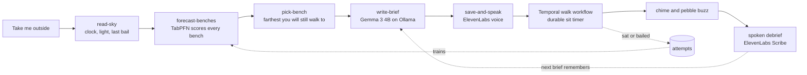

# Stillbench

Sit outside for twelve minutes. Stillbench picks a nearby bench, speaks a short departure brief, then times your sit while the phone stays in your pocket.

Before you go, you can name who the sit is for — a person, a day, or leave it blank. The brief says it once. The home screen remembers the last bench. After you sit, the prompt asks what was here that is not a screen. None of that appears during the sit. The timer stays the only thing on the screen.

If the street is too much, a six-minute sit at the closest bench still counts — the roof is in the pool on purpose. If you are going with someone, the brief includes one line for them, and you can send a check-in with a time and no GPS.

After each real sit you can confirm you were at the bench, and optionally share one line of debrief for the next visitor. The latest brief and voice file stay on the phone for offline replay. Briefs can mention the air outside when `STILLBENCH_HOME` is set (Open-Meteo, no extra key).

Stillbench picks a nearby bench, tells you in plain language why that bench fits today (light, last bail, TabPFN scores), speaks a short Gemma brief, and keeps a quiet timer while you sit. Afterward you can copy a markdown **sit story** for a DEV post—still no GPS. A chime tells you when it is done. Afterwards you say one line about what you noticed, and the next brief remembers it. The screen is the short part. The sit is the product.

## How a walk works



The five steps from the tap to the brief are a Mastra workflow (`src/mastra/workflows/depart.ts`). Each finished or abandoned walk becomes one more row that TabPFN learns from.

## Run it

Gemma 3 4B needs to be available in Ollama:

```bash
ollama pull gemma3:4b
npm install
cp .env.example .env.local
npm run dev
```

Open [http://localhost:3000](http://localhost:3000). **This sit is for** is optional. **Take me outside** is the real twelve-minute sit. **The street is too much** is six minutes at the closest bench. **Sit with someone** adds a line you can play for the person next to you. **Practice sit, twenty seconds** is the same walk with a short timer. Practice sits are not used as training data.

Everything in `.env.example` beyond Ollama is optional. Each key turns on one piece, and the walk keeps working without it. [http://localhost:3000/integrations](http://localhost:3000/integrations) shows which ones are on, which are broken, and what to do next.

| Piece | Turn it on | What changes |
| --- | --- | --- |
| TabPFN | `PRIORLABS_API_KEY` | Bench choice comes from TabPFN instead of a nearest-neighbour baseline |
| ElevenLabs | `ELEVENLABS_API_KEY` | Brief voice, generated chime, spoken debrief |
| Temporal | `TEMPORAL_ADDRESS`, then `npm run temporal:dev` and `npm run worker` | The server finishes the sit even if the phone sleeps, and closes walks you never started |
| Sentry | `SENTRY_DSN` | Agent and workflow traces from Mastra, plus TabPFN, ElevenLabs and Tinker spans |
| MongoDB Atlas | `MONGODB_URI` | Walks and attempts move off local disk, which Render needs |
| SerpApi | `SERPAPI_API_KEY`, `STILLBENCH_HOME`, then `npm run benches:find` | Real parks near home join the hand-picked benches |
| Tinker | `TINKER_API_KEY`, `TINKER_BRIEF_MODEL` | Half the briefs come from a model tuned on the briefs that got you to sit |
| Arduino | `STILLBENCH_DEVICE_TOKEN` | The pocket pebble in `hardware/` buzzes when the sit ends |
| Backboard | `BACKBOARD_API_KEY`, `BACKBOARD_ASSISTANT_ID` | Remembers debriefs; may echo one line in the next Gemma brief |
| Tiger Data | `TIGER_DATABASE_URL` | Append-only `sit_events` in Timescale for analytics |

## What is saved, and where

Each finished sit or bail is appended to `data/attempts.csv` (created from `data/attempts.seed.csv` on first run), or to Atlas when `MONGODB_URI` is set. A row is the hour, how far the bench was, how much light was left, whether the last walk was a bail, and whether you sat. GPS is never read. The spoken debrief is sent to ElevenLabs for transcription and only the text is kept.

## Deploy

### Render

1. Push the repo to GitHub, then in Render choose **New > Blueprint** and pick the repo. `render.yaml` creates the `stillbench` web service on the free plan, running Node 22, with `/api/health` as its health check.
2. Fill in the keys Render asks for. Every one is optional, and anything left empty falls back the same way it does locally. Check `/integrations` on the deployed URL to see what is live.
3. Set `MONGODB_URI` (a free Atlas cluster is enough, with `0.0.0.0/0` on the IP allow list). Render's disk is wiped on every deploy, so without it the walk history resets. On a paid plan you can attach a Render disk instead and set `STILLBENCH_DATA_DIR` to its mount path.
4. To use real parks, set `SERPAPI_API_KEY` and `STILLBENCH_HOME` in Render. Each build runs the park search, so your home never goes into the repo.
5. Render cannot run Ollama. Point `OLLAMA_BASE_URL` at any OpenAI-compatible host that serves Gemma, such as OpenRouter (`https://openrouter.ai/api/v1`, `OLLAMA_MODEL=google/gemma-3-4b-it`, `OLLAMA_API_KEY` set to your OpenRouter key), or at the droplet below. Without one, briefs come from the built-in writer.
6. The durable sit timer is commented out in `render.yaml`. It needs a paid background worker, Temporal Cloud (`TEMPORAL_ADDRESS`, `TEMPORAL_NAMESPACE`, `TEMPORAL_API_KEY`), and `MONGODB_URI` on both services. Leave the Temporal keys empty until then; the phone keeps time on its own.

The free plan sleeps after 15 idle minutes, so the first visit after that takes about a minute. The microphone debrief works on Render because it serves HTTPS.

### DigitalOcean

- `deploy/digitalocean/cloud-init.yaml` builds a droplet that serves Gemma through Ollama behind a bearer token, so the hosted demo still runs on open weights. Point `OLLAMA_BASE_URL` at `https://<droplet-ip>.sslip.io/v1` and set `OLLAMA_API_KEY` to the token.

## The pebble

`hardware/stillbench_pebble` is an Arduino UNO R4 WiFi sketch with a piezo on pin 8. It joins your phone's hotspot, polls `/api/device`, ticks once when you sit, and plays two notes when the twelve minutes are up. The phone can stay in the bag.

## Tuning the brief with Tinker

Real sits count for export when they finished (`status: sat`, not practice) and the brief is not tagged as the built-in template (`model` is not `composer`). If Gemma timed out, the brief may still be good but saved as `composer` — fix that in bulk:

```bash
npm run qualify:walks   # relabel and fill in missing timestamps on real sits
npm run seed:walks      # qualify first, then add fake full cycles until you have 8 exportable sits
```

Then export and train (creates `.venv`, installs Python deps, prints `TINKER_BRIEF_MODEL` to paste into `.env.local`):

```bash
npm run train:briefs
```

`/integrations` shows how many sits are exportable (`8` needed before training).

## Tests

```bash
npm test
```
